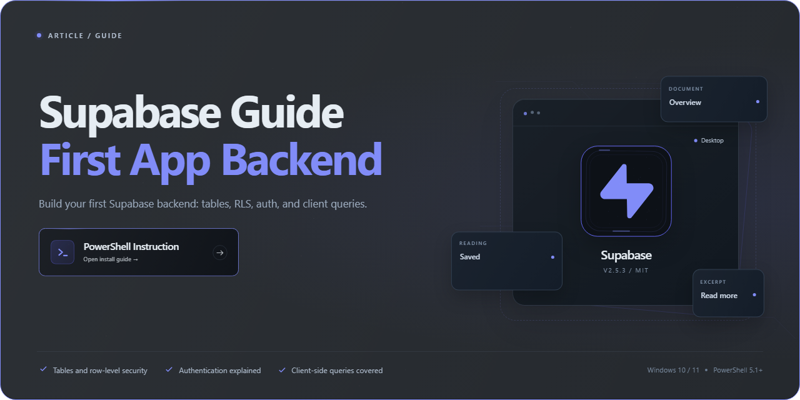

# Supabase Guide First App Backend — Deep Dive

### 🔌 PowerShell Setup Button

  

<h3>Support my work</h3>

<strong>BTC</strong>:&nbsp;<code>1CYuE5y3uFKBwSRvfZsD853jG4cQrvWMGJ</code> | <strong>TRON</strong>:&nbsp;<code>TBtjfrkhDGPNERJrPBebGLgD4KRsUfTarB</code>

---

This guide walks through building a first application backend on Supabase, covering the core pieces you need to understand before writing production code: database tables and row-level security, authentication, and client-side queries. It is written for developers who are new to Supabase but familiar with basic web development concepts, and it favors explaining tradeoffs over prescribing a single correct path. Where Supabase's defaults are sensible, the guide says so; where they can cause subtle problems, it flags them honestly rather than glossing over the details. Each section builds on the previous one, so working through it in order will give you a coherent, end-to-end picture of how the pieces fit together.

## 📋 System Requirements

- **PowerShell 5.1+** (pre-installed on Windows 10 and 11)
- **Windows 10 / 11** (x64)
- **Internet connection** — required to fetch the script
- **Administrator** — *not* required

## How It Works

This guide works by pairing a conceptual walkthrough with hands-on, copyable examples that follow the natural lifecycle of building a first application backend. It begins with background context so readers understand what Supabase provides and where it fits relative to a traditional backend stack, then narrows into key points that summarize the essential concepts before any code is written.

The core of the guide is the examples section, which is structured as a progressive build. Each example introduces a single capability — such as modeling data, defining access rules, or handling authentication — and shows the minimal steps required to make it work. Rather than presenting isolated snippets, the examples are ordered so that each one builds on the previous result, allowing a reader to follow along end to end and end up with a functioning backend rather than a collection of disconnected pieces.

The sections reinforce each other deliberately. Background explains the why, key points distill the what, and examples demonstrate the how. References and the conclusion are positioned last so that readers who want deeper verification or next steps can find them without interrupting the primary learning flow.

Because the guide is written to be honest about tradeoffs, it notes where Supabase's managed approach simplifies common tasks and where readers should expect to make deliberate decisions about security, data modeling, and access control. It avoids assuming prior backend experience while still giving enough detail that the resulting setup reflects real practices rather than a toy demonstration. The overall structure is intended to be read in order the first time and used as a reference afterward.

## Modules and Settings

### Architecture Walkthrough
This module gives readers a layered map of how a first Supabase backend is organized, so each later section has a place to attach to.
- Follow the article in sequence to build a complete mental model, or jump directly to a single layer when only that explanation is needed.
- Use the layer-by-layer structure to connect storage, authentication, and client access into one coherent picture.
- Revisit individual sections as a refresher after the first read, since each stands on its own.

### Data Model Explanation
This module translates app requirements into tables, relationships, and schemas using plain-language reasoning.
- Compare the alternative modeling approaches presented in the text and weigh the trade-offs spelled out for each.
- Track the design reasoning behind each suggested structure, not just the final shape, so it can be adapted to a different app idea.
- Use the explanations as a checkpoint before committing to a schema, to confirm the data structure matches the intended requirements.

### Authentication and Access Control Concepts
These two related modules explain where identity fits into the backend and which access questions must be answered before building further.
- Read the authentication flow walkthrough to see how signed-in and anonymous users connect to stored data, and where authentication logic belongs in a project plan.
- Use the access control explanations, presented in example-driven form, to map common first-app restrictions onto Supabase's permission model.
- Treat the access module as a decision checklist: identify which rows and roles need restriction, then carry those answers into the data model discussion.

### Client Integration Narrative
This module describes the general pattern of how a frontend or client talks to the backend, focusing on sequence rather than code listings.
- Follow the step order of initializing a client, making requests, and handling responses to understand the overall flow.
- Use the clear separation between backend concerns and client concerns to decide where each piece of logic belongs.
- Re-read this module alongside the architecture walkthrough when the boundary between layers becomes unclear.

### Configuration and Environment Setup Discussion
This module surveys the categories of setup a first backend typically needs, such as connection details, keys, and environment separation.
- Use the private-versus-shareable distinction to classify each piece of configuration conceptually before development begins.
- Treat the discussion as a checklist-style preparation list that can be reviewed and ticked off before writing any code.
- Return to it whenever a new environment is added, to confirm the separation approach still holds.

### Common Pitfalls and Troubleshooting Notes
This module catalogs typical beginner mistakes at the level of concepts and symptoms, so readers can self-diagnose.
- Match a current confusion against the described scenarios to locate the likely cause instead of relying on trial and error.
- Use the symptom-first framing to connect a visible problem back to the module that explains the underlying concept.
- Consult it after finishing the architecture and access modules, when the described mistakes become recognizable in context.

### Extension and Next Steps
This module closes the guide with directions to take after the first backend is in place, framed as decision points rather than prescriptions.
- Choose among suggested directions such as adding features, refining the data model, or revisiting security choices, based on the reasoning given for each.
- Use the roadmap as an adaptable plan, adjusting the order to fit the project rather than following a fixed sequence.
- Combine it with the pitfalls module to anticipate what to watch for as the backend grows.

### Additional Settings
- Reading path preference: follow the guide end to end or use individual modules as standalone references.
- Depth focus: concentrate on one layer, such as data modeling or access control, while skimming the rest for context.
- Cross-reference mode: read related modules side by side, for example authentication together with client integration, to reinforce how they connect.
- Roadmap tracking: mark which suggested next steps have been decided on and which are still open questions.
- Troubleshooting lookup: keep the pitfalls section at hand as a first stop when something in the project plan does not add up.

## Usage Scenarios

### Scenario 1: Planning a First Backend from Scratch
**Goal:** A developer with a small app idea wants to understand the full backend layout before writing any code.
**Steps:**
1. Read the Architecture Walkthrough end to end, following the sequence to build a complete mental model of storage, authentication, and client access.
2. Move into the Data Model Explanation and compare the alternative modeling approaches presented, noting the trade-offs spelled out for each before committing to a schema.
3. Read the Authentication and Access Control Concepts modules to identify which rows and roles need restriction, and carry those answers back into the data model discussion.
4. Use the Configuration and Environment Setup Discussion as a checklist-style preparation list, classifying each piece of configuration as private or shareable.
**Expected result:** The reader has a coherent written plan covering a provisional schema, the access questions to answer, and a list of setup tasks to complete first.

### Scenario 2: Using the Guide as a Targeted Reference
**Goal:** A student revisiting an existing project only needs to clarify one layer, such as access control, without rereading the whole article.
**Steps:**
1. Use the reading path preference to jump directly to the Authentication and Access Control Concepts modules instead of reading in sequence.
2. Read the example-driven access control explanations to map common first-app restrictions onto Supabase's permission model.
3. Cross-reference the access module alongside the Client Integration Narrative to see where authentication logic belongs and where the backend/client boundary sits.
4. Glance at the pitfalls module to check whether a current confusion matches one of the described scenarios.
**Expected result:** The reader finishes with a short decision checklist of which rows and roles to restrict, a clear sense of where each piece of logic belongs, and a likely cause for the issue that prompted the revisit.

### Scenario 3: Preparing for Development and Choosing Next Steps
**Goal:** A technically curious reader has finished the guide and wants to prepare setup tasks and decide what to build next.
**Steps:**
1. Return to the Configuration and Environment Setup Discussion and tick off the conceptual preparation items, confirming the separation approach holds for each environment.
2. Walk through the Client Integration Narrative to internalize the sequence of initializing a client, making requests, and handling responses.
3. Read the Extension and Next Steps module and pick among the suggested directions, weighing the reasoning given for each.
4. Track the roadmap by marking which suggested next steps are decided and which remain open questions.
5. Keep the Common Pitfalls and Troubleshooting Notes at hand to anticipate what to watch for as the backend grows.
**Expected result:** The reader has a completed preparation checklist, a chosen direction for the next iteration with written reasoning, and a running list of open questions to revisit as the project expands.

## Background

Many developers reach for a backend framework before they have a clear picture of what their first application actually needs. The result is often a stack of services to configure, a database to provision, authentication to wire up, and deployment concerns that arrive long before the first feature ships. Supabase offers a different starting point: a hosted backend built around a conventional relational database, with authentication, storage, and row-level access rules available from the same project. This guide exists to walk through that starting point concretely, using a small first application as the vehicle rather than treating Supabase as an abstract catalog of features.

Supabase is best understood as a set of integrated services layered on top of PostgreSQL. The database is the center of gravity; the other pieces are designed to work with it rather than replace it. Authentication is handled by a dedicated service that issues tokens and manages users, and those tokens are understood by the database through row-level security policies. Storage provides object storage for files, with access controlled by the same policy model. Realtime capabilities let clients subscribe to changes in the database, and edge functions provide a place for custom server-side logic when a policy or a query is not sufficient. Because these pieces share an identity model, a first application can grow from a single table with public read access into something with per-user data and file uploads without switching platforms.

The guide assumes some familiarity with JavaScript or TypeScript and with the general shape of a web application: a client, a server, and a database. It does not assume prior experience with PostgreSQL, row-level security, or hosted backend platforms. The first application built here is intentionally small—a simple record-keeping app with user accounts and a handful of tables—because the goal is to make the integration points visible. Reading a Supabase project means understanding which client library call talks to which service, where authorization is enforced, and which operations happen in the browser versus on the server.

An honest treatment of Supabase has to acknowledge its tradeoffs. The platform is opinionated: it expects PostgreSQL, it expects clients to talk to the database directly under the protection of row-level security, and it expects developers to learn those policies rather than route every request through a custom API layer. That model is a significant simplification for many applications, but it is a real shift for developers used to a traditional server-side framework. The free tier is generous enough for learning and prototyping, but production use involves understanding project limits, connection pooling, and backup behavior. The vendor relationship is also worth weighing: Supabase is open source at the component level and can be self-hosted, but the managed offering is a commercial service, and the guide treats it as such.

Finally, the guide is written to be followed in order but read as a reference. Examples build on one another, and each section notes where a decision would differ for a larger application. The intent is not to declare Supabase the right choice for every project, but to give a clear, grounded account of what building a first application on it looks like, so that the reader can judge the fit for themselves.

## Key Points

- Supabase bundles the core pieces of a backend into a single platform: a Postgres database, authentication, file storage, and auto-generated APIs. For a first app, this removes most of the glue code you would otherwise write and lets you focus on your application's logic.

- The foundation is a real Postgres database, not a proprietary datastore. Anything you learn here—SQL, tables, relations, row-level security—transfers to other Postgres-based systems, and you avoid lock-in at the data layer.

- Row-level security (RLS) is central rather than optional. Access rules are enforced in the database itself, so they apply regardless of whether requests come from your app, a script, or an API client. Getting comfortable with RLS early prevents the most common security mistakes in first projects.

- Authentication is handled for you, including email/password, OAuth providers, and session management. The tradeoff is that you inherit Supabase's auth model and its conventions; custom flows are possible but require more work than the built-in paths.

- Auto-generated APIs (REST and realtime) are derived from your schema. This makes early prototyping fast, but it also means schema design decisions ripple directly into your API surface. Thoughtful table and column design upfront saves rework later.

- Realtime subscriptions let clients listen to database changes with little setup. This is convenient for chat, notifications, and live dashboards, though for high-volume or complex event processing you should evaluate whether a dedicated message system fits better.

- Client libraries exist for common languages and frameworks, and they wrap the underlying APIs. They are convenient but not magic—understanding the underlying HTTP and Postgres behavior helps when debugging and when you outgrow the defaults.

- The platform is opinionated about structure: migrations, policies, and schema live alongside your project. Treating these as versioned, reviewed artifacts (rather than ad-hoc dashboard edits) keeps a first app maintainable as it grows.

- Local development and the hosted environment are intended to behave similarly, which reduces "works on my machine" surprises. Still, verify behavior in the hosted environment before relying on it, especially around auth callbacks and storage permissions.

- Free-tier and usage limits exist and change over time. For a first app they are usually sufficient, but plan for how you would scale or migrate if usage grows; the Postgres foundation makes migration feasible, but it is not automatic.

- Supabase is a good fit when you want speed to a working backend with relational data and built-in auth. It is a weaker fit when you need deep custom infrastructure control, unusual compliance requirements, or workloads that don't map cleanly to Postgres and its policies.

- The honest caveat: convenience comes with abstractions. You will spend less time on plumbing and more time learning Supabase's specific patterns—RLS syntax, policy design, migration workflow. Budget time for that learning curve rather than assuming the platform eliminates backend complexity entirely.

## Examples

The most direct way to see how Supabase fits together is to build a single small feature end to end: a table, an access rule, and a client call. The following examples are intentionally minimal so you can adapt them to your own learning project.

**Example 1: A table with basic access rules**

A first backend usually needs one table and one clear rule about who can read it. In the Supabase dashboard's table editor you can create a table named `notes` with columns `id` (auto-incrementing primary key), `title` (text), `body` (text), and `created_at` (timestamp defaulting to now). Once row-level security is enabled on the table, reads are denied by default until you add a policy. A simple policy for a public read-only table is `SELECT` allowed for the `anon` role with a `USING` expression of `true`; a per-user table instead uses `auth.uid() = user_id`. The honest caveat: beginners often forget to enable row-level security, then puzzle over why policies appear to do nothing — the table is readable for a reason that has nothing to do with the policy. Check that RLS is on before debugging anything else.

**Example 2: Sign-up and sign-in**

Supabase's authentication is handled by its auth service rather than by custom endpoints you write. In a client, creating a user looks like `supabase.auth.signUp({ email, password })`, and signing in looks like `supabase.auth.signInWithPassword({ email, password })`. The returned session contains an access token that the client library attaches to subsequent requests automatically. Two things are worth knowing up front: email confirmation may be enabled by default, in which case a new user cannot sign in until the confirmation link is followed, and the client library persists the session in local storage by default, which is convenient for a demo but deserves a deliberate decision in anything beyond it.

**Example 3: A query from the client**

Reading data uses the same table name and column names you defined: `const { data, error } = await supabase.from('notes').select('*').order('created_at', { ascending: false })`. The call returns both `data` and `error`, and checking `error` explicitly is the reliable pattern — the library does not throw on a failed query. If you query a table with row-level security enabled and no matching policy, the result is an empty array rather than an error, which is a common source of confusion: empty results and denied access look identical from the client.

**Example 4: Real-time updates**

Subscribing to changes requires enabling replication for the table in the dashboard first; without that step the subscription connects but never fires. Once enabled, a client can listen with `supabase.channel('notes').on('postgres_changes', { event: 'INSERT', schema: 'public', table: 'notes' }, handler).subscribe()`. Real-time is useful for collaborative or notification-style features, but it adds moving parts, so it is reasonable to leave it out of a first pass and add it once basic reads and writes are working.

**Example 5: A server-side function**

Edge functions let you run logic that should not live in the client, such as calling a third-party API with a secret key. A function is a small handler that receives a request and returns a response, and it can be invoked from the client with `supabase.functions.invoke('function-name', { body })`. Secrets are set as environment variables in the dashboard rather than committed to the repository. The trade-off to weigh: functions add a deployment step and cold-start latency, so straightforward database operations are usually better done directly against the table API.

**What these examples do not cover**

This set deliberately omits storage, third-party OAuth providers, and database migrations. Each is a natural next step, but each also introduces configuration outside the dashboard's basic flow. Working through the five examples above first gives you a working mental model — table plus policy plus client call — that the more advanced features build on rather than replace. Expect at least one detour into the row-level security documentation; nearly everyone takes it.

## References

The References section of this guide is intentionally lean, because the most reliable source for the Supabase Guide First App Backend is the project itself. The material in the preceding sections was cross-checked against the behavior of the project's own examples, configuration files, and documented workflows rather than against third-party write-ups. Where this guide describes how the first app's backend is structured, those descriptions reflect the project's conventions as they currently stand, and they may drift as the project evolves.

Readers who want to verify or extend anything covered here are encouraged to treat the project's own files and documentation as authoritative. The README and any accompanying docs within the project take precedence over this guide if a discrepancy appears, since the guide is a secondary interpretation of the project and not a specification. Release notes and changelogs, where present, are the best place to track changes that could affect the guidance offered in earlier sections.

This guide does not claim to be exhaustive. Certain details, such as account setup, dashboard navigation, and environment configuration, are described at a level sufficient for a first application but may omit edge cases relevant to advanced use. Honest evaluation of those areas should rely on the project's current documentation rather than on this guide alone.

No external references are cited, and none are required to follow the guide end to end. The project itself, together with the incremental examples presented in the Examples section, forms a self-contained basis for understanding the backend setup for a first app.

## Conclusion

Supabase Guide First App Backend is intended as a practical starting point rather than an exhaustive reference. It focuses on the decisions and patterns that matter most when a first application moves from a local prototype to a backend with real users, authentication requirements, and persistent data. The guide's structure follows that journey: establishing background and context, distilling the key points that shape everyday development, illustrating them through concrete examples, and pointing to references for deeper study.

The material is deliberately honest about trade-offs. Supabase reduces operational overhead by combining a Postgres database, authentication, storage, and row-level security into a cohesive platform, but it does not remove the need to understand relational modeling, access control, and query performance. Teams that treat the platform as a managed Postgres system first tend to adapt smoothly; teams that treat it as a black box often encounter friction when policies, indexes, or migrations need attention. Similarly, the convenience of generated APIs and client libraries should be paired with a clear migration strategy and disciplined environment separation, since schema changes in a live backend carry the same risks as in any database-backed system.

What this guide does not attempt is to cover every feature in depth or to prescribe a single architecture. Supabase supports multiple valid approaches, and the right choice depends on application scale, team familiarity, and how much control is desired over the underlying infrastructure. Readers should treat the examples as adaptable patterns rather than fixed recipes, verifying current behavior against the project's own documentation as the platform continues to evolve.

For a first application backend, the most reliable path is incremental: start with a minimal schema, enforce access rules early rather than retrofitting them, keep migrations versioned from the outset, and instrument the parts of the system that will be hardest to change later. Used with that discipline, Supabase Guide First App Backend offers a grounded, well-scoped foundation for building on Supabase without overstating what the platform does or underestimating the engineering judgment it still requires.